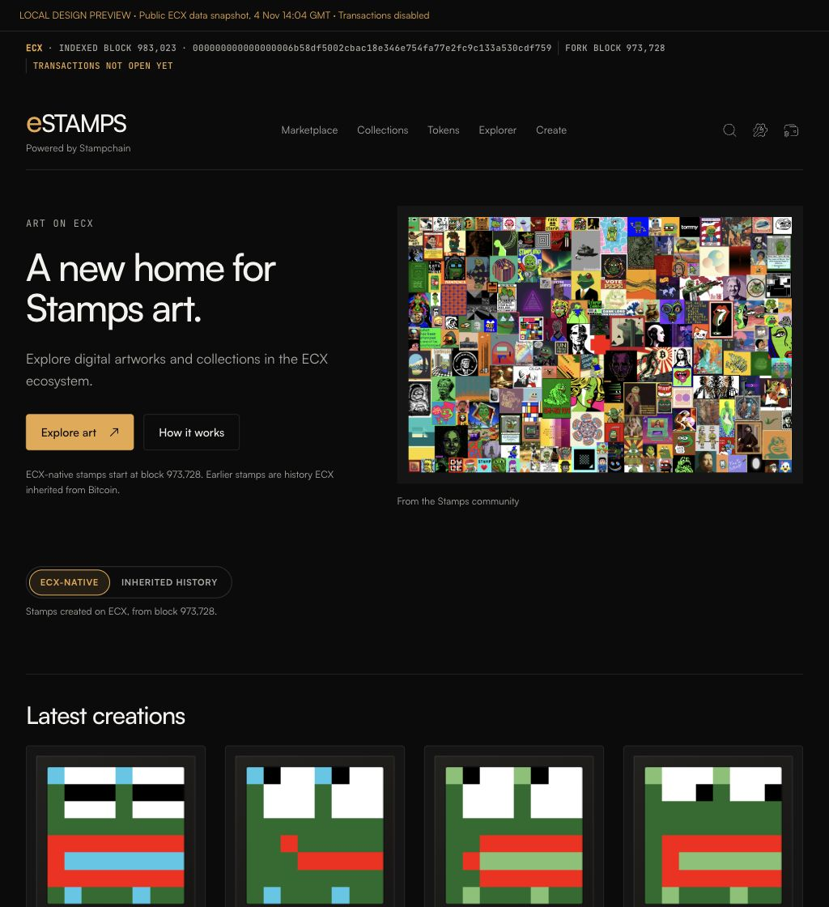

# eSTAMPS art direction — review, 4 November 2026

This presentation pass is based on main `7e3cd554b44302f9c07dc6c8c557ed63a6520294`, after the eSTAMPS branding and eSTAMP numbering changes. It carries over the Satoshi/JetBrains Mono typography, accessible wordmark, quiet header/footer, split introduction and undimmed community artwork, artwork captions and amber/neutral controls.

## Browser previews

These are local design previews using public ECX API data fetched on 4 November 2026 at 14:04 GMT, with stamp images from the ECX host. The snapshot was indexed to block 983,023 and contains seven native artworks, including eSTAMP #142 and #0, plus the five current minting tokens. The local preview disables broadcasting; its transaction status is not the production site's status. Temporary snapshot wiring, service URLs and preview labels are excluded from the implementation.

## Validation

Using the project-pinned Deno 2.6.9: formatting, lint, full `deno check .`, and `deno task build` pass. The targeted `estamps`, `ecxPostFork`, `estampNumber` and `chainLabelling` suites pass: 48 tests, zero failures. Immutable Bitcoin JSON baselines are unchanged; Bitcoin header/footer renders also match the base exactly.

Browser inspection covered 320, 400, 768 and 1024 CSS pixels with no horizontal overflow. The wallet chooser opens at each width. Public artwork images load, and captions keep the existing native/inherited numbering. No wallet connection, signing or transaction was performed. Operator review and Arwyn's real browser/wallet user test remain pending before deployment.

The existing homepage history switch has a separate partial-navigation issue: the unchanged handler returns 204 for `Sec-Fetch-Dest: empty`. This also reproduces on the live ECX site; a full document load works. It is outside this presentation change.
